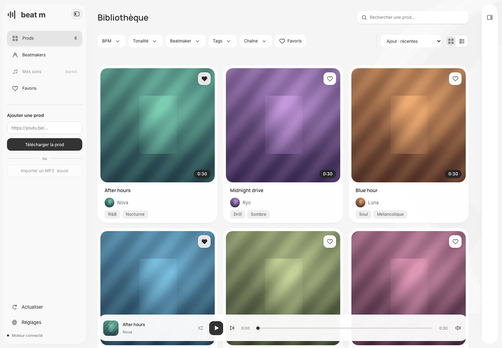
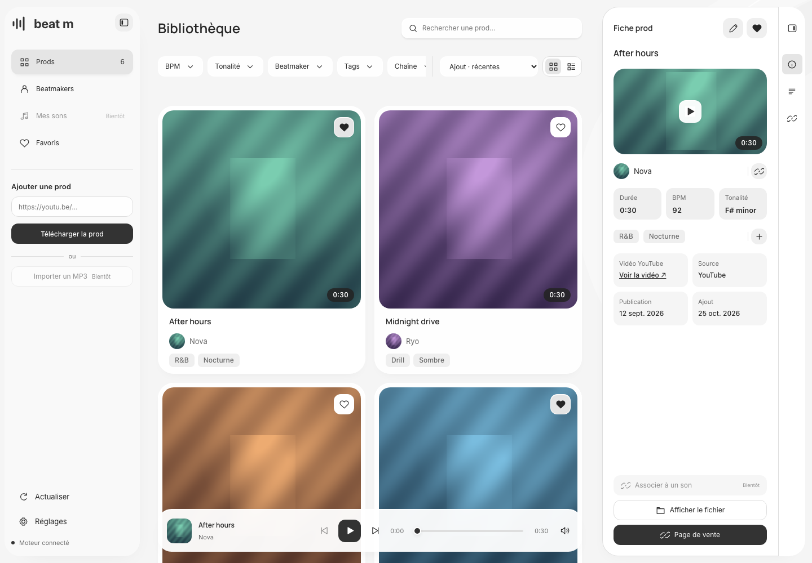
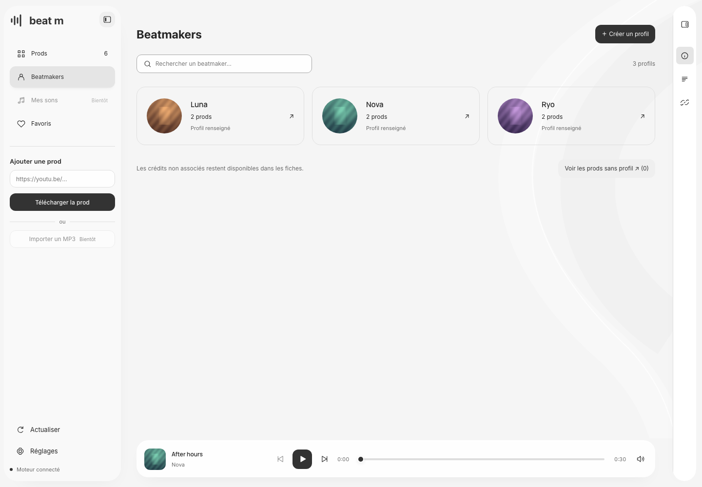

# Beat m

Tes prods, au même endroit. Une bibliothèque locale pour importer des beats YouTube, les retrouver par pochette, BPM, tonalité ou tags, et les écouter avant de les glisser dans ton logiciel de musique.



## Ce que tu peux faire

- Importer une vidéo YouTube en MP3 avec sa pochette et ses informations disponibles.
- Combiner recherche, BPM, tonalité, tags, beatmakers, chaîne et favoris.
- Écouter avec un lecteur qui reste actif pendant la navigation.
- Corriger les informations d'une prod et retrouver son fichier dans Finder.
- Gérer les profils beatmakers, leurs collaborations, liens et portraits.
- Conserver fichiers et catalogue SQLite dans une bibliothèque transportable.

Deux dispositions, grandes pochettes ou cartes horizontales, et quatre palettes en clair et sombre. Après import, la recherche et l'écoute fonctionnent hors ligne lorsque le moteur local tourne.

| Fiche d'une prod | Profils beatmakers |
| --- | --- |
|  |  |

*Captures de l'application avec un catalogue fictif, des pochettes originales et un audio synthétique. Aucun média personnel n'est fourni.*

## Installer et lancer

Version en développement, utilisable sur **Mac**. Prérequis : [uv](https://docs.astral.sh/uv/getting-started/installation/), [Node.js 24](https://nodejs.org/) et [FFmpeg / ffprobe](https://ffmpeg.org/download.html) dans le `PATH`. uv installe Python 3.13 si nécessaire.

```sh
git clone https://github.com/kylliandelbauche/yt-beat-m.git
cd yt-beat-m
uv sync --locked
npm --prefix frontend ci
npm --prefix frontend run build
uv run yt-beat-m doctor
uv run yt-beat-m serve
```

Le navigateur s'ouvre sur **http://127.0.0.1:8765**. Garde le terminal ouvert ; `Ctrl+C` arrête le moteur. Aucune clé API ni fichier `.env` n'est nécessaire.

1. Dans **Réglages → Bibliothèque**, crée une bibliothèque dans un dossier vide ou ouvre une bibliothèque existante.
2. Colle un lien vidéo dans **Importer**. La fiche s'ouvre lorsque la prod est prête.
3. Filtre, écoute, puis utilise **Afficher le fichier** pour retrouver le MP3.

L'application s'exécute sur ton ordinateur ; elle n'héberge pas ta collection. Les imports et portraits YouTube utilisent Internet. Les fichiers et le catalogue restent dans le dossier que tu choisis.

## Limites actuelles

Une vidéo par import, de 30 minutes maximum. Les vidéos privées, cookies de navigateur et playlists entières ne sont pas pris en charge. L'analyse des boutiques, la classification audio par IA et **Mes sons** sont prévues, pas encore disponibles. Les métadonnées manquantes peuvent être corrigées manuellement ; les tonalités utilisent la notation anglaise (`Ab minor`, `E major`).

Windows et le lanceur à double-clic sont reportés. Le format conserve des chemins relatifs, mais la recette matérielle Windows reste à faire. Une bibliothèque s'utilise sur une seule instance à la fois ; arrête le moteur avant d'éjecter son disque.

Importe uniquement les contenus pour lesquels tu disposes des autorisations nécessaires. Télécharger une prod ne remplace pas sa licence d'utilisation.

## Développer et contribuer

React · TypeScript · Vite · Python · FastAPI · SQLite · yt-dlp · FFmpeg.

```sh
uv run ruff check .
uv run ruff format --check .
uv run pytest
npm --prefix frontend run lint
npm --prefix frontend run build
npm --prefix frontend exec playwright install chromium
npm --prefix frontend run test:e2e
```

Les tests navigateur utilisent une bibliothèque temporaire et de l'audio synthétique. GitHub Actions reste **manuel**, pour maîtriser sa consommation.

[Guide d'utilisation](docs/usage.md) · [Contribuer](CONTRIBUTING.md) · [Architecture](docs/architecture.md) · [Issues](https://github.com/kylliandelbauche/yt-beat-m/issues) · [Kanban](https://github.com/users/kylliandelbauche/projects/2)

## Sécurité et licence

Pour signaler une vulnérabilité, consulte [SECURITY.md](SECURITY.md). Le moteur est conçu pour un usage local, sans compte utilisateur ; il ne doit pas être exposé sur Internet.

Code sous [licence MIT](LICENSE). Les polices incluses conservent leurs [licences SIL Open Font License](frontend/public/fonts/README.md). Cette licence ne s'applique pas aux contenus musicaux importés.
