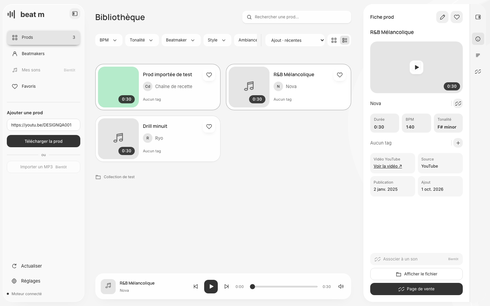
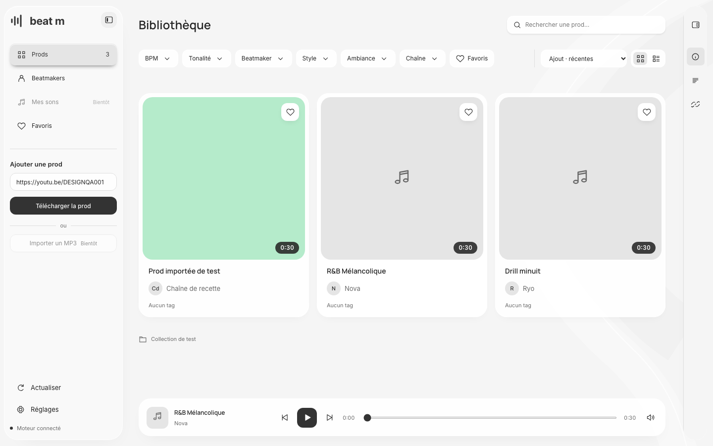
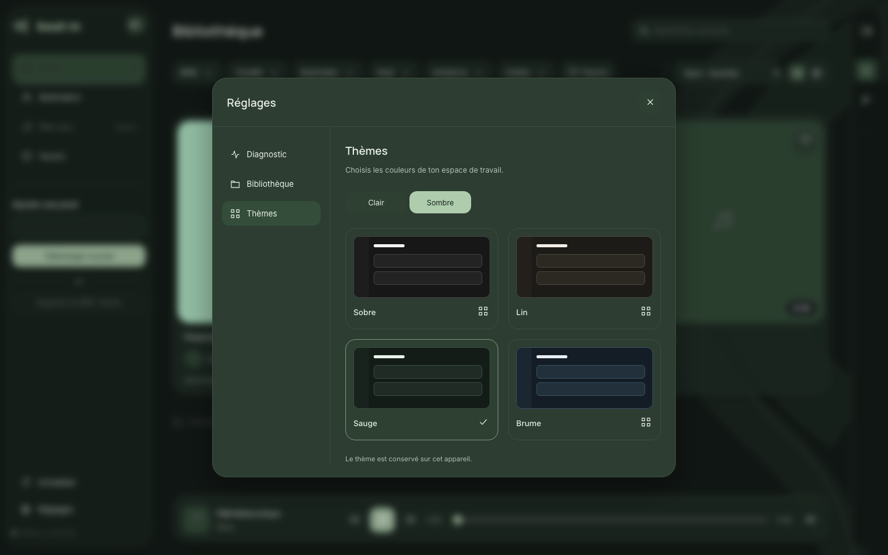

# Interface Paper Officiel — #78

Référence active du 30 octobre 2026 : [Paper Beat m](https://app.paper.design/file/01M5QR97GBV3NSMTMD9TXHX51N/p-A-0). Cette révision remplace les anciennes références de pop-up de prod, couleurs, typographie et cartes. Les illustrations musicales de Paper ne sont pas des données du catalogue.

## Sources natives et arbitrages

Les exports JSX, styles, tokens et captures ont été consultés directement dans Paper, sans reprendre le prototype HTML isolé de l’agent design.

| Page | Références utilisées |
| --- | --- |
| 10 · Accueil | ACC01–08 ; ACC09/10 pour les grandes pochettes |
| 20 · Fiche prod | FP01–05 ; FP02 actualisée depuis UA7-0 |
| 30 · Réglages | REG01–05 |
| 80 · Composants | HC-04 UKT-0, états TCO-0 / TF1-0, grandes pochettes UFT-0 / UGV-0, tags UOP-0, tonalité, volume, import et volets |

Les décisions complémentaires relayées par l’agent Paper sont consignées dans #78 :

- Annuler → Crayon/Enregistrer → Favori, aux positions x152/194/236 de l’en-tête de 272 px. Trois emplacements de 36 × 36 px ; Annuler masqué et non focalisable en lecture. Le cœur reste à droite.
- HC-04 est la carte horizontale approuvée : hauteur 136 px, pochette 120 × 120, titre en haut, beatmaker dessous et tags en bas, sans séparateur. Les essais intermédiaires ne sont pas intégrés.
- Grandes pochettes approuvées : largeur + 108 px de hauteur, soit 344 × 452 ou 368 × 476 selon les colonnes ; retrait de 8 px pour l’image carrée ; bloc inférieur cliquable, sans séparateur.
- Tags informatifs dans les deux dispositions : hauteur 24, rayon 7, survol selected/ink et graisse inchangée ; une ligne défilable, sans compteur +N. Le clic dans la zone textuelle ouvre la fiche.
- Une sélection de tags ou de beatmakers ne devient un brouillon qu’à sa confirmation ; Save enregistre et Annuler restaure l’ensemble.
- Les profils Beatmakers existants restent fonctionnels, avec les styles communs. Mes sons, l’association à un son et l’import MP3 extérieur sont désactivés « Bientôt » ; le scan MP3 existant est conservé.
- Le choix d’un dossier prépare le chemin. Seule la validation explicite ouvre ou crée la bibliothèque. Saisie manuelle et création sont conservées dans le contenu défilant des réglages.
- La petite fenêtre conserve provisoirement les mêmes colonnes avec défilement horizontal, sans volet superposé. Ce n’est pas une nouvelle maquette mobile approuvée.

## Géométrie et état

À 1440 × 900, navigation 256/80 px et colonne de fiche 384/72 px. La fiche visible mesure 360 px, avec marges de 12 px. Le centre se recalcule réellement ; le volet ne masque pas le catalogue. Les contours décoratifs sont peints vers l’intérieur pour conserver les coordonnées de Paper.

Les positions de la fiche sont communes à la lecture, l’édition, l’attente et aux retours de sauvegarde : titre sur une ligne, pochette 272 × 152, identités, cellules musicales et dates, description fixe et actions inférieures. Les erreurs sont hors du flux avec une action accessible. Le succès est une coche et une annonce accessible.

Le sélecteur de tonalité flotte sous la cellule dans un cadre 224 × 52 ; ses listes défilent sans agrandir ce cadre. L’entrée « Non renseignée » conserve la possibilité préexistante de vider une tonalité. La notation reste anglaise. Les sélecteurs flottants suivent le défilement et rendent le focus au déclencheur sur Échap.

Un seul élément audio reste monté pour la piste active pendant recherches, filtres, consultation des fiches, profils, thèmes et changement de disposition. Le lecteur possède une position de lecture, précédent/suivant parmi les prods affichées et un volume vertical 72 × 224 avec mute/rétablissement. Les préférences audio existantes sont conservées. Les erreurs média disposent d’une relance.

Les huit variantes Sobre/Lin/Sauge/Brume × clair/sombre utilisent les tokens natifs. Sobre clair est le défaut ; palette et mode sont mémorisés localement. Inter et Manrope sont servis localement avec leurs licences OFL et `font-display: optional`.

## Vérification locale

- 255 tests backend : catalogue, tags par prod et pagination, migrations, stockage, sécurité locale, extraction et imports, corrections et profils.
- 38 scénarios Chromium : volets et états sans sélection, deux dispositions, géométrie des textes/champs/actions à 1440 et 720 px, description, tonalité au clavier, tags, brouillons, focus, huit thèmes, lecture et volume, doublon réel, progression et reprise d’import, filtres, réglages, sélecteur de dossier, profils, pagination, erreurs et relances.
- Consultation, fontes et lecture avec requêtes Internet bloquées ; accès aux commandes à 390 px avec le défilement provisoire.
- Compilation, lint, Ruff et vérification du diff. Aucune CI hébergée lancée.

Les bibliothèques et médias de recette sont temporaires. Le téléchargeur réseau est simulé uniquement dans le serveur de test ; les API, transactions et médias locaux restent réels. L’écoute physique, l’ouverture du Finder et le glisser-déposer dans le logiciel musical restent des vérifications utilisateur distinctes.

Les anciennes recettes UI liées à la fiche modale centrée, aux polices remplacées et aux précédentes dimensions ont été remplacées par la recette #78. Les garanties métier sont reprises dans `redesign.spec.ts` et `reliability.spec.ts`, avec conservation et adaptation des recettes profils, dossiers et extraction des tonalités. Leur historique reste disponible dans Git.

## Captures de la recette

Catalogue temporaire avec médias et données de test ; aucune donnée de la bibliothèque personnelle.

