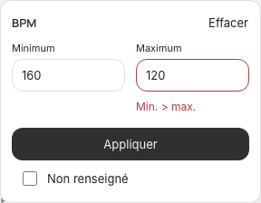
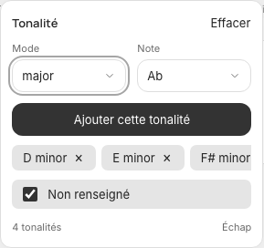
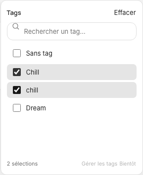

# Filtres et tags communs — #80

Références : [Paper / Composants et règles](https://app.paper.design/file/01M5QR97GBV3NSMTMD9TXHX51N/p-C-0), familles BPM, Filtre tonalités, Listes recherchables et Favoris/tri/disposition. Exports JSX, styles calculés et captures natifs consultés ; tokens conservés.

- BPM : cadre 288 × 224, aide sur une ligne ; erreur uniquement sous Maximum, avec emplacement réservé et bordure de couleur, sans changement de taille. Les bornes égales filtrent un BPM exact ; Non renseigné reste combinable.
- Tonalités : cadre 288 × 272 ; Mode/Note puis Ajouter, sans recherche ni cases de tonalités. Les critères anglais s’ajoutent en tags retirables sur une ligne défilante/glissable, sans compression ni +N. Changer Mode/Note seul ne modifie pas les critères. Ajouter est désactivé si la combinaison est déjà sélectionnée ; retirer un critère rend le focus au compositeur. Le sous-menu reçoit le focus ; Échap le ferme avant le menu parent.
- Tags : cadre 288 × 352 ; une liste commune remplace Style/Ambiance. Recherche tolérante à la casse/aux accents ; sélection exacte d’un libellé. Cases 32/gap 4. Sans tag peut se combiner avec des libellés. OU dans une catégorie, ET entre catégories.
- Disposition : cadre 70 × 36, padding vertical 3/horizontal 4, cellules 28/rayon 7 ; fenêtres de noms de beatmakers hautes de 20.
- La petite fenêtre conserve le défilement horizontal provisoire de #78. Le centre minimum de 480 permet de garder un accès aux filtres à côté des commandes fixes de tri/disposition.

Revue visuelle : BPM, hiérarchie et espacements alignés sur la référence, erreur contenue sous Maximum ; tonalités, valeurs et actions alignées dans un cadre constant, défilement sans compression ; tags, cases séparées et pied fixe. Les exemples des maquettes ne sont pas ajoutés au catalogue.

## Migration et compatibilité

Schéma 5 : `catalog_tags` et `beat_catalog_tags` ajoutent un vocabulaire commun et une relation plusieurs-à-plusieurs ordonnée. La migration réunit seulement les libellés strictement identiques (comparaison binaire), y compris lorsqu’ils venaient de deux catégories. Casse, accents, espaces et formes Unicode des libellés existants restent conservés. Les tables, identifiants, catégories et associations historiques restent intacts à la migration.

Le mécanisme de bibliothèque sauvegarde SQLite avant migration et exécute toutes les étapes dans une transaction. Une erreur conserve l’ancienne version ; le réessai et le déplacement de bibliothèque sont vérifiés. Aucun média ni chemin n’est renommé.

L’API ajoute `tags` aux prods, détails et options, et `tags`/`tag_missing` aux filtres. La sauvegarde commune conserve l’ordre de sélection, archive la première valeur et ses origines, et ne touche que les associations explicitement envoyées. Une suppression d’association commune retire aussi l’association historique correspondante ; ses origines sont archivées. Les anciens champs styles/moods restent acceptés et préservent les tags communs sans catégorie. Un PATCH ne peut pas mélanger les deux conventions.

## Périmètre et suites

La création depuis Choisir mes tags reste disponible. Créer sélectionne immédiatement le nouveau tag dans le sélecteur ; confirmer prépare le brouillon, Save enregistre l’entité et son association. Fermer sans confirmer ou annuler la fiche conserve les valeurs enregistrées. La création de doublon exact est désactivée.

La gestion du catalogue appartient à #81. La dernière clarification produit conserve la création dans la fiche et place renommage/suppression dans Réglages → Tags ; la nouvelle présentation y est en revue. L’entrée Gérer les tags est indiquée Bientôt dans ce lot, pour ce découpage. Finitions et animations sont suivies en #82. Aucune de ces fonctions supplémentaires n’est développée dans #80.

## Vérification

261 tests moteur : conservation d’une bibliothèque 4 peuplée, variantes, associations partagées, sauvegarde, déplacement/réouverture, reprise après échec, ordre, corrections/vidage, compatibilité des anciens champs et API protégée. 42 scénarios navigateur, avec revalidations ciblées des menus, de la création/association différée et du glisser horizontal. Géométrie et clavier vérifiés à 1440 et 390 ; lecture et focus conservés. Compilation, lint, Ruff et diff vérifiés localement ; aucune CI hébergée.

Le build de recette peut être servi séparément via `BEAT_M_TEST_FRONTEND` par le serveur de tests, sans remplacer la version locale consultée pendant le développement. Les tests n’utilisent que des bibliothèques temporaires.

## Captures de recette

Données temporaires uniquement, captures limitées aux composants.

