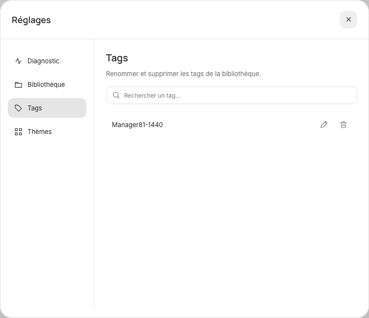
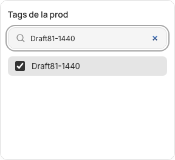

# Tags : une seule sauvegarde et gestion centrale (#81)

Référence : [Paper, page 50, REG-06 Officiel](https://app.paper.design/file/01M5QR97GBV3NSMTMD9TXHX51N/p-E-0). JSX, styles calculés et capture natifs consultés ; tokens existants conservés. Le contrat « Un seul Enregistrer pour la fiche » remplace la confirmation intermédiaire de #80.

## Parcours et géométrie

Le + active l’édition puis ouvre un popover ancré de 288 × 264. En-tête à 12/12, recherche à 12/44 (262 × 36), liste à 12/92 (262 × 144), choix 32/gap 4. Créer, dans cette même recherche, sélectionne immédiatement le tag dans le brouillon. Cocher/décocher modifie directement le brouillon ; fermer avec Échap, le + ou un clic extérieur le conserve. Aucun bouton Utiliser la sélection. Le Save de la fiche crée les tags et associations atomiquement ; Annuler ne crée rien.

Réglages → Tags et Gérer les tags du filtre ouvrent la même rubrique. Pas de création depuis le filtre ou les réglages. Le dialogue garde 752 × 648 ; contenu 512 × 520, recherche y72/h36, liste y128/h288, lignes 44/gap 4, actions 32 et glyphes 16. Le crayon devient une coche ; la corbeille devient Annuler au même emplacement. L’input 36 commence à x8/y4 ; padding 3 + bordure 1 alignent son texte avec le libellé x12. Confirmation, attente et erreurs utilisent la zone réservée y432/h80. Le dialogue et la liste ne grandissent pas selon l’état.

Sur petite fenêtre, la navigation des réglages devient une seule ligne défilante, le contenu reste accessible dans sa zone et les actions gardent leurs cibles. Les rubriques Bibliothèque, Diagnostic et Thèmes restent disponibles, ainsi que toutes les palettes/modes. Les finitions et compromis de #82 ne sont pas intégrés ici.

## Identité et conservation

Migration 6 : `catalog_tag_names` mémorise les libellés actuels, anciens noms et retraits, avec l’identifiant alloué. Sauvegarde SQLite préalable et transaction existantes. Aucun renommage/déplacement de média. À la migration, toutes les entités, associations ordonnées et lignes historiques restent intactes.

Un renommage conserve l’ID commun et ses associations partagées ; les anciennes références textuelles se résolvent vers le nom courant. Une suppression confirmée retire l’entité et ses associations communes/historiques, conserve les prods, médias et provenances, et laisse un marqueur de retrait. Une ancienne fiche ou un ancien client ne peut pas recréer silencieusement ce tag : le PATCH est refusé sans écriture partielle. La création explicite depuis le sélecteur peut envoyer `recreate_tags` avec les tags sélectionnés, au Save seulement ; une nouvelle identité est alors allouée. Les IDs supprimés ne sont pas réutilisés.

La liste renvoie ID/libellé/nombre de prods. PATCH et DELETE `/api/catalog/tags/{id}` exigent la session/origine locale et `expected_label`. Une collision ou une modification concurrente retourne 409 et conserve la saisie. Actualiser la liste permet de relire la version courante avant de réessayer. Les variantes exactes restent distinctes ; aucune fusion approximative. Les corrections globales rafraîchissent le catalogue, la fiche et les filtres actifs sans recréer l’audio ni écraser un brouillon.

## Vérification

Tests moteur : migration 5→6 avec sauvegarde et rollback, persistance/déplacement, associations partagées/variantes, identité stable, concurrence, anciennes références, suppression/recréation explicite, sécurité et médias conservés. Tests navigateur : parcours Save/Annuler sans tag orphelin, retour du focus, lecteur/position conservés, gestion commune depuis les deux accès, renommage avec erreur/réessai, confirmation/annulation/suppression, géométrie et clavier à 1440 et 390. Les tests utilisent uniquement des bibliothèques temporaires ; aucune CI hébergée.

Validation locale : 267 tests moteur et 46 scénarios navigateur réussis, puis quatre revalidations ciblées après ajustement du retour de focus et du contour de recherche. Compilation, lint, Ruff et diff vérifiés. Revue visuelle : cadres et espacements conformes aux exports, hiérarchie lisible, contraste des tokens conservé, actions alignées dans leurs colonnes, contenu contenu dans les zones fixes et liste défilante. Captures de recette ci-dessous, données temporaires uniquement.

