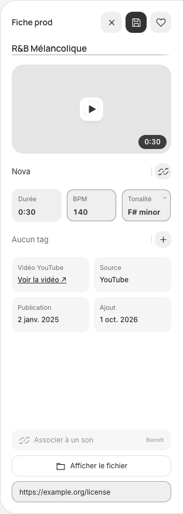
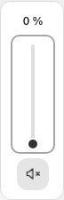
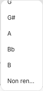

# Finitions Paper Officiel — #82

Références consultées : [Composants et règles](https://app.paper.design/file/01M5QR97GBV3NSMTMD9TXHX51N/p-C-0), FIN01/FIN02, C-KEY-PROD et audit [AUD-01/02](https://app.paper.design/file/01M5QR97GBV3NSMTMD9TXHX51N/p-G-0). Exports JSX, styles calculés et captures natifs utilisés ; tokens existants conservés. Les données illustratives ne sont pas injectées dans le catalogue.

## Corrections

- Navigation repliée 64 px, cibles de 44 px centrées, rayons 12 et ombre externe seule sur la sélection. Suppression du reflet supérieur. Le panneau d’import replié suit la nouvelle largeur et reste accessible sur petite fenêtre.
- Volet : rail 48, bouton 36/glyphe 18, séparation unique 1 et même surface que le contenu. Le volet visible ouvert reste 360 px rail inclus (colonne 384, marges 12). Les gouttières 24 du centre et le padding 16 du lecteur restent conservés.
- Cartes : rayon 28 sans agrandissement des dispositions. Fiche : Save accent/onaccent dans le même emplacement 36, durée sans contour d’édition, BPM readonly sans spinners. Les valeurs musicales restent en anglais.
- Sélecteur de disposition 70 × 36 : cellules 28 immobiles ; le fond seul glisse 32 px en 180 ms. Les deux largeurs de colonnes sont interpolées sur 200 ms ; les autres éléments qui en dépendent suivent le même calcul. Une interruption repart de la largeur courante. Mouvement réduit : bascule immédiate.
- Volume 72 × 224 : sortie 20 à y12, zone interactive44 × 128 à y40, piste 4 × 112, poignée visible 14 et mute 36 à y176. Enfants positionnés dans le cadre, sans dépassement ni masquage du focus. La progression utilise la même piste 4/poignée 14. Les inputs natifs portent les interactions, les spans décoratifs dessinent les rails ; le focus reste visible sur la zone. Home/End sont normalisés aux valeurs min/max, y compris en orientation verticale RTL. Volume, mute/rétablissement, clavier et glisser sont conservés.
- Liste de notes : maximum 184 avec défilement interne. En fenêtre basse, elle s’ouvre au-dessus lorsque nécessaire ou réduit sa hauteur disponible, sans agrandir le popover de tonalité 52. Le choix vide préexistant reste disponible ; ses libellés tiennent sur une ligne avec texte complet accessible au survol et aux lecteurs d’écran.

## Conservation et limites

Aucune modification du moteur, de l’API, du schéma, des données ou des médias. Les 267 tests moteur réussis de #81 restent réutilisés ; aucune nouvelle migration ni réexécution de ces tests pour une correction purement frontend. Un seul élément audio persiste pendant les changements de disposition et de volets.

Les compromis non validés restent hors livraison : réserve de galerie/fond opaque du lecteur, coque de description 248 contre 280 (zone utile 224 inchangée), aperçu unique des thèmes et édition de la source YouTube. La superposition et les surfaces existantes ne sont pas réinterprétées ici. Les fonctions Bibliothèque et Tags de #81 sont conservées.

## Recette

Contrôles locaux : dimensions/contenus/actions fixes à 1440 et 390, état Save et readonly, clic/glisser/clavier des deux sliders jusqu’aux extrémités, absence de scroll du volume et poignée contenue, focus restauré. Mesures à chaque frame d’interruptions des deux volets, adaptation du centre/lecteur, icônes de disposition fixes, mouvement réduit et conservation de l’élément audio/position. Liste des notes contrôlée dans une fenêtre 900 × 520. Bibliothèques temporaires uniquement, aucune CI hébergée.

Résultat : 52 scénarios navigateur réussis, puis trois revalidations ciblées après alignement du rayon/ombre du volume et des libellés de notes ; compilation, lint et diff sans erreur. Revue visuelle des captures : espacements et alignements maintenus, Save identifiable sans déplacement, contraste des tokens conservé, poignée et focus contenus, liste de notes accessible. Les captures ci-dessous ne contiennent que les données de recette temporaires.

